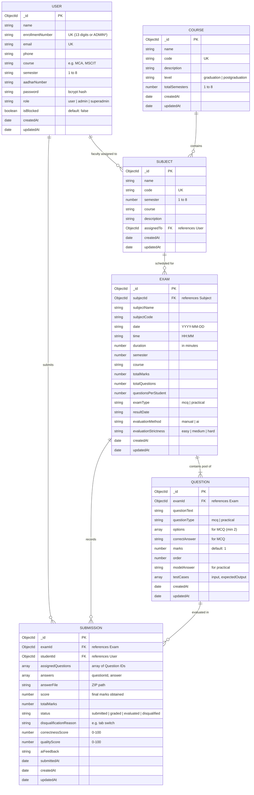
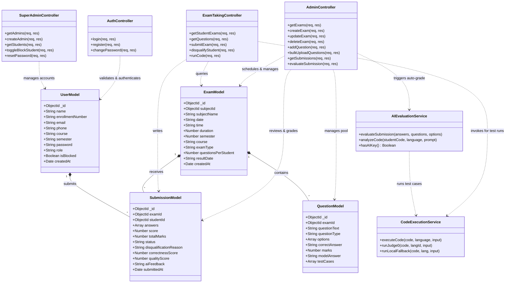
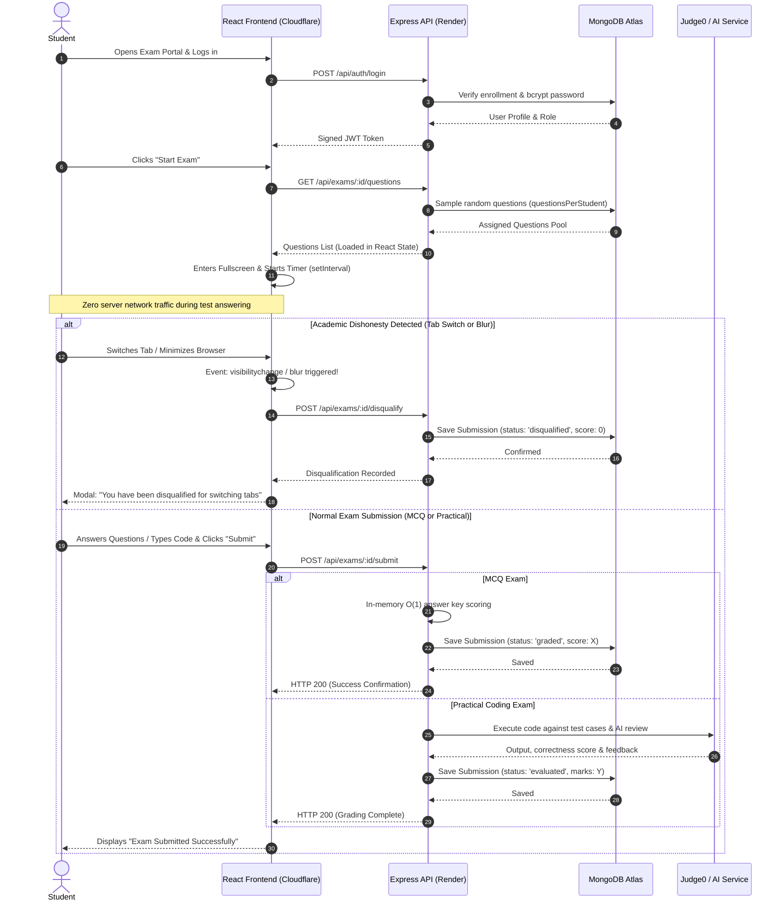
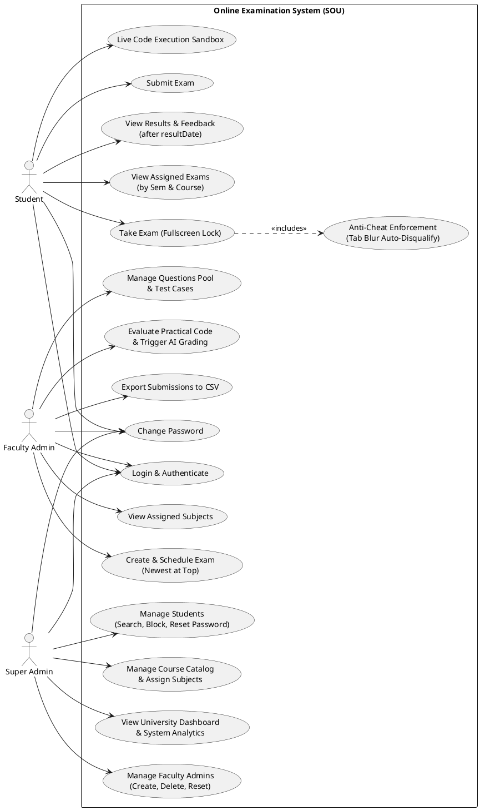

# Online Examination System (SOU) — Draw.io Diagram Codes

This document contains diagram codes ready to paste directly into **[draw.io](https://app.diagrams.net/)**.

---

## How to Paste into Draw.io (Step-by-Step)
1. Open **[draw.io](https://app.diagrams.net/)** (or the Draw.io Desktop app).
2. Create a blank diagram.
3. In the top toolbar, click **`+` (Insert)**.
4. Hover over **`Advanced`**.
5. Choose **`Mermaid`** or **`PlantUML`** depending on the diagram below.
6. Paste the code into the text area.
7. Click **`Insert`**. Draw.io will automatically render the shapes, connectors, and layout!

---

## 1. Entity-Relationship (ER) Diagram (Mermaid)

> **Paste in Draw.io via:** `+` &rarr; `Advanced` &rarr; `Mermaid`

---

## 2. UML Class Diagram (Mermaid)

> **Paste in Draw.io via:** `+` &rarr; `Advanced` &rarr; `Mermaid`

---

## 3. UML Sequence Diagram: Student Exam & Anti-Cheat Flow (Mermaid)

> **Paste in Draw.io via:** `+` &rarr; `Advanced` &rarr; `Mermaid`

---

## 4. UML Use Case Diagram (PlantUML)

> **Paste in Draw.io via:** `+` &rarr; `Advanced` &rarr; `PlantUML`

