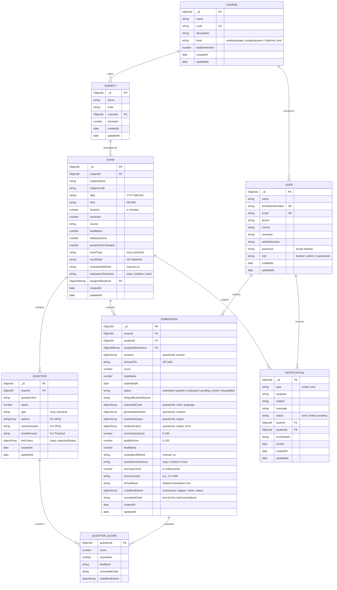

# Entity-Relationship Diagram (ERD) & Database Schema Specification
**Project**: ACUMEN — AI-Driven Code Understanding & Monitored Examination Network  
**Subtitle**: Intelligent Practical Code Assessment & Real-Time Integrity Guardian  
**Institution**: Silver Oak University (SOU), Ahmedabad  
**Author**: Het Patel (MCA Semester 3)  
**Database Engine**: MongoDB (Mongoose ODM)

---

## 1. Visual Entity-Relationship Diagram (Mermaid)

---

## 2. Detailed Collection & Schema Specifications

### 2.1 Collection: `users`
Stores all platform users across the three primary roles: Students, Faculty/Admins, and System Super Administrators.

| Field Name | Data Type | Constraints | Description |
| :--- | :--- | :--- | :--- |
| `_id` | ObjectId | Primary Key, Auto | Unique document identifier |
| `name` | String | Required, Trimmed | Full legal name of student or faculty |
| `enrollmentNumber` | String | Required, Unique, Indexed | SOU Enrollment ID (e.g., `23010101`, `ADMIN001`) |
| `email` | String | Required, Unique, Indexed | Institutional or personal email address |
| `phone` | String | Optional, Indexed | 10-digit mobile number for SMS alerts |
| `course` | String | Required for students | Enrolled program (e.g., `MCA`, `MScIT`) |
| `semester` | String | Required for students | Current semester (e.g., `3`) |
| `aadharNumber` | String | Optional, Masked | Secondary identification credential |
| `password` | String | Required | Salted bcrypt hash ($2a$10$) |
| `role` | String | Enum: `['student', 'admin', 'superadmin']` | Authorization role (Default: `'student'`) |
| `createdAt` / `updatedAt` | Date | Auto timestamps | Audit trail timestamps |

---

### 2.2 Collection: `courses`
Stores academic programs offered at Silver Oak University.

| Field Name | Data Type | Constraints | Description |
| :--- | :--- | :--- | :--- |
| `_id` | ObjectId | Primary Key | Unique course identifier |
| `name` | String | Required, Trimmed | Program title (e.g., `Master of Computer Applications`) |
| `code` | String | Required, Unique, Indexed | Short code (e.g., `MCA`, `BCA`, `MScIT`) |
| `description` | String | Optional | Detailed description of the curriculum |
| `level` | String | Enum: `['undergraduate', 'postgraduation', 'diploma', 'phd']` | Degree level |
| `totalSemesters` | Number | Min: 1, Max: 10 | Duration of the course in semesters |

---

### 2.3 Collection: `subjects`
Stores subjects linked to specific courses and semesters.

| Field Name | Data Type | Constraints | Description |
| :--- | :--- | :--- | :--- |
| `_id` | ObjectId | Primary Key | Unique subject identifier |
| `name` | String | Required | Subject name (e.g., `Python Programming`) |
| `code` | String | Required, Indexed | Subject code (e.g., `MCA301`) |
| `courseId` | ObjectId | Ref: `Course`, Required | Parent course relation |
| `semester` | Number | Required, Min: 1 | Semester in which the subject is taught |

---

### 2.4 Collection: `exams`
Stores scheduled examinations and assessment configurations.

| Field Name | Data Type | Constraints | Description |
| :--- | :--- | :--- | :--- |
| `_id` | ObjectId | Primary Key | Unique exam identifier |
| `subjectId` | ObjectId | Ref: `Subject`, Required | Associated subject reference |
| `subjectName` | String | Required | Denormalized display name |
| `subjectCode` | String | Required | Denormalized subject code |
| `date` | String | Required, `YYYY-MM-DD` | Scheduled calendar date |
| `time` | String | Required, `HH:MM` | Exam start time (24-hour format) |
| `duration` | Number | Required, Min: 15, Max: 300 | Duration allowed in minutes |
| `semester` | Number | Required | Target student semester |
| `course` | String | Required | Target student course program |
| `totalMarks` | Number | Default: 100 | Maximum possible score |
| `totalQuestions` | Number | Default: 0 | Total question pool size |
| `questionsPerStudent`| Number | Default: 0 | Random subset count assigned to each student |
| `examType` | String | Enum: `['mcq', 'practical']` | Examination mode |
| `resultDate` | String | Optional, Datetime | Result publication embargo timestamp |
| `evaluationMethod` | String | Enum: `['manual', 'ai']` | Practical grading method |
| `evaluationStrictness`| String | Enum: `['easy', 'medium', 'hard']` | AI evaluation stringency level |
| `assignedStudents` | Array[ObjectId] | Refs: `User` | Students eligible for this exam |

---

### 2.5 Collection: `questions`
Stores individual questions belonging to an exam question bank.

| Field Name | Data Type | Constraints | Description |
| :--- | :--- | :--- | :--- |
| `_id` | ObjectId | Primary Key | Unique question identifier |
| `examId` | ObjectId | Ref: `Exam`, Required | Parent exam reference |
| `questionText` | String | Required | Problem statement or question prompt |
| `marks` | Number | Required, Min: 1 | Question weightage in marks |
| `type` | String | Enum: `['mcq', 'practical']` | Question format |
| `options` | Array[String] | Optional (MCQ) | 4 multiple choice options |
| `correctAnswer` | String | Optional (MCQ) | Correct option string |
| `modelAnswer` | String | Optional (Practical) | AI or faculty reference code solution |
| `testCases` | Array[Object] | Optional (Practical) | Input/expectedOutput validation testcases |

---

### 2.6 Collection: `submissions`
Stores student exam answers, runtime telemetry, AI evaluations, and proctoring status.

| Field Name | Data Type | Constraints | Description |
| :--- | :--- | :--- | :--- |
| `_id` | ObjectId | Primary Key | Unique submission identifier |
| `examId` | ObjectId | Ref: `Exam`, Required | Examination reference |
| `studentId` | ObjectId | Ref: `User`, Required | Student reference |
| `assignedQuestions` | Array[ObjectId] | Refs: `Question` | Questions assigned from randomized pool |
| `answers` | Array[Object] | Array of `{ questionId, answer }` | Submitted answers or code scripts |
| `score` | Number | Default: 0 | Total scored marks |
| `totalMarks` | Number | Default: 0 | Total available marks |
| `submittedAt` | Date | Default: `Date.now` | Final submission timestamp |
| `status` | String | Enum: `['submitted', 'graded', 'evaluated', 'pending_review', 'disqualified']` | Current submission lifecycle status |
| `disqualificationReason` | String | Optional | Reason if disqualified (e.g. 3 tab switches) |
| `correctnessScore` | Number | 0 – 100 | Execution testcase accuracy percentage |
| `qualityScore` | Number | 0 – 100 | AI algorithmic quality score |
| `finalMarks` | Number | Computed | Final aggregate marks awarded |
| `evaluationMethod` | String | `'manual'` or `'ai'` | Evaluation engine used |
| `executionTime` | Number | In milliseconds | Sandbox execution duration |
| `memoryUsed` | String | e.g. `'14.2 MB'` | Memory consumption in sandbox |
| `aiFeedback` | String | Text | Formatted AI constructive feedback |
| `questionScores` | Array[Object] | Per-question breakdown | Itemized scores, breakdown, and annotated code |
| `codeBreakdown` | Array[Object] | Component breakdown | `{ component, codeSnippet, maxMarks, awardedMarks, status, comment }` |
| `annotatedCode` | String | Formatted code | Student code annotated with line-by-line awarded marks |

---

## 3. Relationships & Cardinality Rules

1. **Course to Subject (`1 : N`)**: A single Course (e.g., MCA) contains multiple Subjects across 4 semesters. A Subject belongs to exactly one Course.
2. **Subject to Exam (`1 : N`)**: A Subject can have multiple examinations scheduled across academic sessions. Each Exam is tied to one Subject.
3. **Exam to Question (`1 : N`)**: An Exam maintains a pool of Questions. In randomized mode, a subset is assigned per student.
4. **Student to Exam Submission (`1 : 1`)**: Compound unique index `{ examId: 1, studentId: 1 }` guarantees a student can only submit once per scheduled exam.
5. **Exam to Submission (`1 : N`)**: An exam receives submissions from all enrolled students.
6. **Submission to Question Scores (`1 : N`)**: A practical submission stores granular construct-level mark allocations for every assigned question.
