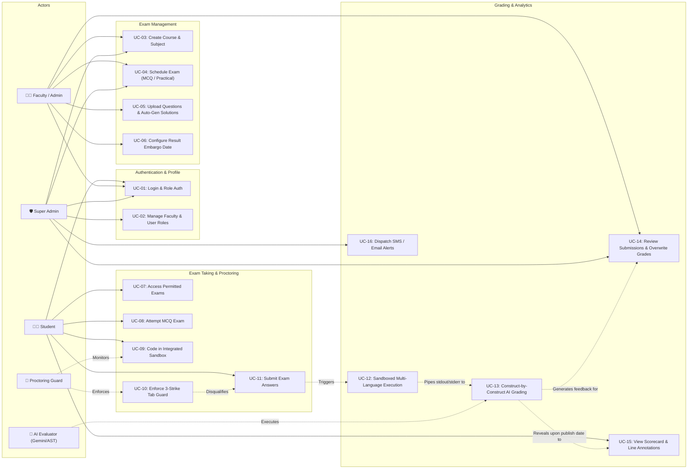

# Use Case Diagram & System Specifications
**Project**: SOU SmartExam — Online Examination & Intelligent Assessment Platform  
**Institution**: Silver Oak University (SOU), Ahmedabad  
**Author**: Het Patel (MCA Semester 3)

---

## 1. Visual Use Case Diagram (Mermaid)

---

## 2. Actor Profiles & Roles

| Actor | Type | Description & Responsibilities |
| :--- | :--- | :--- |
| **Student** | Human User | Enrolled university candidate. Views scheduled exams matching their course and semester, takes timed assessments, writes and tests code in the integrated compiler, and reviews line-by-line evaluation breakdowns post-publication. |
| **Faculty / Admin** | Human User | Departmental teacher/examiner. Creates and manages subjects, schedules MCQ and practical coding exams, uploads question pools, configures grading strictness, reviews student submissions, and overrides grades if needed. |
| **Super Admin** | Human User | Institutional administrator. Manages user provisioning, assigns faculty administrative privileges, seeds courses, monitors system performance, and triggers broadcast notifications. |
| **AI Evaluator** | Automated Subsystem | Dual-tier grading engine combining Google Gemini 1.5 Flash LLM and an intelligent AST heuristic decompiler. Analyzes code logic, assigns construct-by-construct marks, and computes line annotations. |
| **Proctoring Guard** | Automated Subsystem | Client-side security monitor. Enforces full-screen mode, tracks browser window-blur and tab changes, manages clipboard events, issues warning modals, and disqualifies upon 3 strikes. |

---

## 3. Core Use Case Specifications

### UC-01: User Authentication & Role Authorization
- **Primary Actor**: Student, Admin, Super Admin
- **Preconditions**: User has valid credentials (enrollment number/email + password).
- **Trigger**: User navigates to the login portal.
- **Main Success Scenario**:
  1. User inputs enrollment number and password.
  2. System validates input format and queries the `users` collection.
  3. Bcrypt verifies the salted password hash against the stored hash.
  4. System generates a signed JSON Web Token (JWT) containing `id`, `role`, and `name`.
  5. User is redirected to their respective role-based dashboard (`/dashboard`, `/admin`, `/superadmin`).
- **Alternative Flows**:
  - *Invalid Credentials*: System displays error message and denies token generation.
  - *First-time Student*: Student self-registers; system verifies course and semester before granting student access.

---

### UC-04: Schedule Examination (MCQ / Practical)
- **Primary Actor**: Faculty / Admin, Super Admin
- **Preconditions**: Admin is authenticated; Course and Subject already exist.
- **Main Success Scenario**:
  1. Admin selects Course, Semester, and Subject.
  2. Admin enters Exam Date (`YYYY-MM-DD`), Start Time (`HH:MM`), and Duration (minutes).
  3. Admin chooses **Exam Type**: `MCQ` or `Practical`.
  4. For Practical exams, Admin configures **Evaluation Method** (`AI` or `Manual`) and **Strictness** (`Easy`, `Medium`, `Hard`).
  5. Admin sets an optional **Result Date** (embargo date before which scores stay hidden from students).
  6. Admin specifies Total Questions and Questions Per Student (enabling randomized pooling).
  7. System persists the new exam document in MongoDB and returns confirmation.

---

### UC-05: Question Bank Ingestion & Auto-Solution Synthesis
- **Primary Actor**: Faculty / Admin
- **Preconditions**: Exam created; Question statement ready.
- **Main Success Scenario**:
  1. Admin uploads question CSV (e.g. `"Write a Python function to reverse a string",10`) or adds via modal.
  2. For MCQ: Admin specifies 4 options and the correct answer string.
  3. For Practical: Admin inputs question text and total marks.
  4. If reference model answer or testcases are omitted, the **Solution Generator Service** automatically prompts the AI to generate a working ground-truth model answer and executes it in the sandbox to produce verified test cases.
  5. Question is saved and linked to `examId`.

---

### UC-09: Integrated Sandbox Code Execution
- **Primary Actor**: Student
- **Preconditions**: Practical exam session is active.
- **Main Success Scenario**:
  1. Student selects programming language (Python, JavaScript, Java, C, C++, HTML/CSS, React).
  2. Monaco editor loads language-specific syntax highlighting and starter boilerplate.
  3. Student writes solution and clicks **"Run Code"**.
  4. System dispatches code and standard input to the isolated sandbox executor.
  5. Sandbox executes code with timeout limits (5 seconds) and returns `stdout`, `stderr`, and exit code.
  6. Student sees live execution output in the terminal panel for instant verification.

---

### UC-10: 3-Strike Tab Guard & Anti-Cheating Enforcement
- **Primary Actor**: Proctoring Guard Subsystem
- **Preconditions**: Student is actively taking an examination.
- **Main Success Scenario**:
  1. Proctoring guard attaches listeners to `visibilitychange` and window `blur` events.
  2. If the student switches browser tabs or minimizes the window:
     - Warning modal triggers immediately with remaining strike count.
     - Warning sound and toast message are displayed.
  3. Legitimate single accidental clicks allow resuming after acknowledging the modal.
  4. If the student reaches **3 strikes**:
     - System immediately closes the exam interface.
     - Calls `/api/exams/:examId/disqualify`.
     - Marks submission status as `'disqualified'`, records reason, and zeroes marks.

---

### UC-13: Construct-by-Construct Automated AI Evaluation
- **Primary Actor**: AI Evaluator Subsystem
- **Preconditions**: Student submits a practical coding exam.
- **Main Success Scenario**:
  1. Backend receives student submitted code and question metadata (total marks: e.g. 45).
  2. Code is first compiled/executed against verified test cases in the sandbox.
  3. Dual-tier evaluation runs:
     - **Tier 1 (AI Review)**: Gemini 1.5 Flash inspects problem intent, algorithms, and accuracy.
     - **Tier 2 (AST Decompiler)**: Decomposes code into function interface, guard conditions, core computation loops, and returns.
  4. Allocates the question's total marks (e.g. 45) across constructs:
     - Boundary / Edge Case Condition: `if (num < 0) return "Undefined";` $\rightarrow$ **22 Marks**.
     - Core Computation Loop: `for (let i = 2; i <= num; i++) result *= i;` $\rightarrow$ **23 Marks**.
  5. Generates annotated code showing line-by-line mark allocations.
  6. Persists `score`, `codeBreakdown`, `annotatedCode`, and `aiFeedback` in MongoDB.

---

### UC-15: Scorecard & Line-by-Line Breakdown Inspection
- **Primary Actor**: Student
- **Preconditions**: Exam completed and `resultDate` has passed (or no embargo set).
- **Main Success Scenario**:
  1. Student visits `/dashboard` and clicks **"Check Submission"**.
  2. Backend verifies that current datetime $\ge$ `resultDate`.
  3. System renders the **AI Evaluation Results Card**:
     - Overall Score and Percentage (`45 / 45` - `100%`).
     - Correctness Score % and Code Quality Score %.
     - Execution time and Peak memory usage.
  4. System renders the **Code Component Marks Breakdown Table**:
     - Component name, code snippet, awarded vs max marks, status badge (`✅ Correct`, `⚠️ Partial`, `❌ Missing`), and remarks.
  5. System renders the **Annotated Code View** displaying the exact line-by-line marks awarded.
