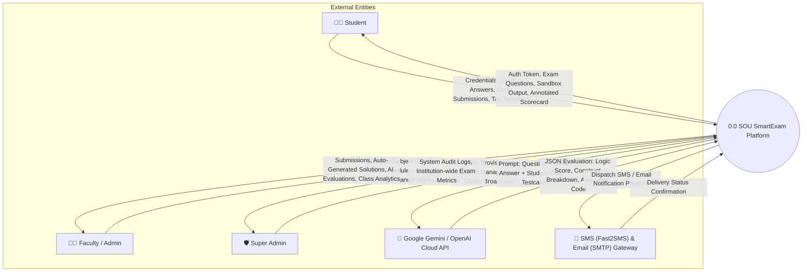
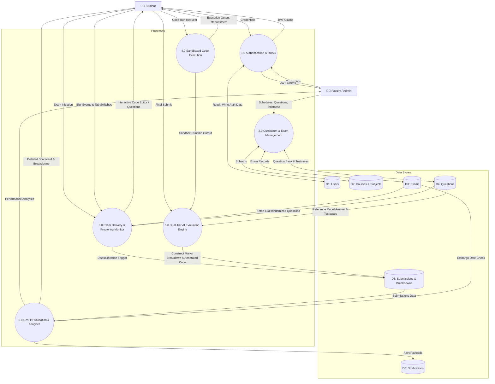
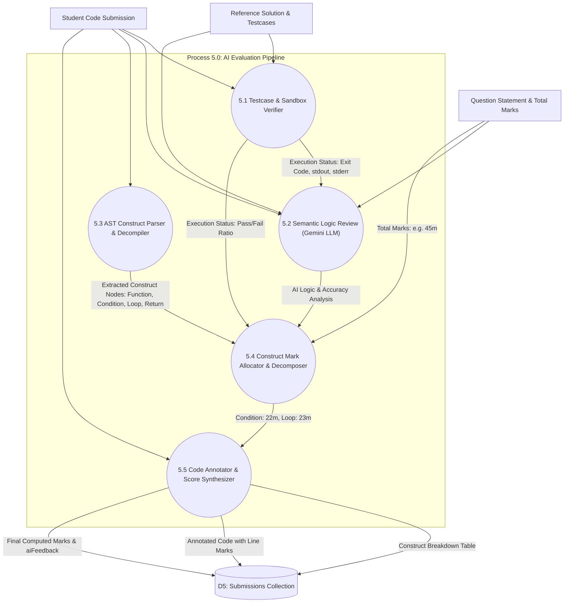

# Data Flow Diagrams (DFD) — Level 0, Level 1 & Level 2
**Project**: SOU SmartExam — Online Examination & Intelligent Assessment Platform  
**Institution**: Silver Oak University (SOU), Ahmedabad  
**Author**: Het Patel (MCA Semester 3)

---

## 1. DFD Level 0 — Context Diagram

The Context Diagram defines the system boundary, external entities interacting with the application, and the primary input/output data flows.

---

## 2. DFD Level 1 — System Process Decomposition

Decomposes the core system into 6 discrete functional processes and identifies interactions with physical MongoDB data stores.

---

## 3. DFD Level 2 — Decomposition of Process 5.0 (AI Code Evaluation)

Provides an in-depth breakdown of how practical student code submissions are automatically transformed into granular construct-by-construct scores.

---

## 4. Data Dictionary: Key Data Flows

| Data Flow Name | Source Process/Entity | Destination Process/Entity | Data Elements |
| :--- | :--- | :--- | :--- |
| `Student Submission` | Student Portal | Process 5.0 | `examId`, `studentId`, `answers: [{ questionId, answer, language }]` |
| `Execution Telemetry` | Process 4.0 (Sandbox) | Process 5.0 | `exitCode`, `stdout`, `stderr`, `executionTime`, `memoryUsed` |
| `AST Construct Map` | Process 5.3 | Process 5.4 | `foundComponents: [{ type: 'condition', lineIndex: 1, codeSnippet: 'if (num < 0)...' }]` |
| `Construct Allocation` | Process 5.4 | Process 5.5 | `breakdown: [{ component, codeSnippet, maxMarks, awardedMarks, status, comment }]` |
| `Evaluation Result` | Process 5.5 | D5: Submissions | `score`, `totalMarks`, `correctnessScore`, `qualityScore`, `codeBreakdown`, `annotatedCode` |
| `Published Scorecard`| Process 6.0 | Student Portal | Detailed marks, component table, line-by-line annotations, feedback summary |
