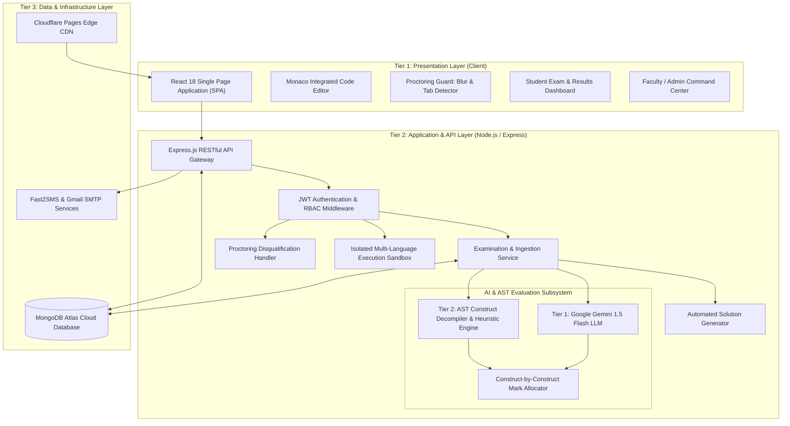

# Software Architecture & System Design Document
**Project**: ACUMEN — AI-Driven Code Understanding & Monitored Examination Network  
**Subtitle**: Intelligent Practical Code Assessment & Real-Time Integrity Guardian  
**Institution**: Silver Oak University (SOU), Ahmedabad  
**Author**: Het Patel (MCA Semester 3)

---

## 1. High-Level 3-Tier Architectural Overview

ACUMEN is engineered as a decoupled, resilient, cloud-native 3-tier architecture designed to sustain high concurrent student exam traffic while providing sub-2-second automated AI grading.



---

## 2. Frontend Architecture (React 18 & Monaco Editor)

### 2.1 State Management & Component Hierarchy
- **Framework**: React 18 with functional components and React Hooks (`useState`, `useEffect`, `useCallback`, `useRef`).
- **Build Tool**: Vite (bundling and hot module replacement with $< 600\text{ ms}$ production build times).
- **Core View Modules**:
  - `Login.jsx` / `Register.jsx`: Multi-role onboarding with validation.
  - `Dashboard.jsx`: Student examination hub, exam countdowns, active exam sessions, and rich AI scorecards.
  - `AdminDashboard.jsx`: Comprehensive exam scheduling, question management, live submissions monitor, and manual grading overrides.
  - `SuperAdminDashboard.jsx`: University-wide user management, course seeding, and notification broadcasts.
  - `CodeEditor.jsx`: High-performance Monaco editor supporting syntax highlighting, indentation, multi-cursor editing, and execution output consoles.

### 2.2 Client-Side Proctoring Guard Implementation
To prevent student malpractice during exams, the frontend attaches event listeners to window focus, document visibility, and key combinations:

```javascript
// Tab-Switch & Blur Detection in Dashboard.jsx
useEffect(() => {
  if (!takingExam || submission) return;

  const handleBlur = () => {
    setTabWarnings(prev => {
      const next = prev + 1;
      if (next >= 3) {
        disqualifyCurrentExam('Exceeded 3 tab-switch / window-blur violations');
      } else {
        toast.error(`Warning ${next}/3: Do not leave the examination window!`);
      }
      return next;
    });
  };

  window.addEventListener('blur', handleBlur);
  document.addEventListener('visibilitychange', () => {
    if (document.hidden) handleBlur();
  });

  return () => {
    window.removeEventListener('blur', handleBlur);
  };
}, [takingExam, submission]);
```

---

## 3. Dual-Tier AI & AST Evaluation Pipeline

### 3.1 Pipeline Architecture
The evaluation service operates on a **dual-tier architecture** ensuring that evaluation never fails even during external API downtime:

1. **Sandbox Execution & Testcase Verification**:
   - Compiles and runs the code against verified input/output pairs in an isolated runtime environment.
   - Captures `exitCode`, `stdout`, `stderr`, execution duration, and peak memory consumption.
2. **Tier 1 — Generative AI Semantic Analysis (Gemini 1.5 Flash)**:
   - When `GEMINI_API_KEY` is present, the LLM analyzes problem intent, algorithmic optimality, edge cases, and assigns marks directly across code constructs.
3. **Tier 2 — AST Construct Decompiler & Heuristic Fallback**:
   - If offline or AI key is absent, the system's pattern decompiler analyzes the code constructs (function interface, guard conditions, iteration loops, and return statements) and applies the exact same construct marks breakdown!

### 3.2 Signature Innovation: Construct-by-Construct Decomposition
For a question worth $N$ marks (e.g., 45 marks):
- **Condition Marks**: $\lfloor N / 2 \rfloor$ (e.g., 22 marks) allocated to boundary/edge-case checks.
- **Loop Marks**: $N - \lfloor N / 2 \rfloor$ (e.g., 23 marks) allocated to core iteration logic.
- **Fault-Tolerant Scoring**: Deducts only the construct that failed or was omitted; rewards correct algorithms independently.
- **Zero-Length Bias**: 1-line concise recursive solutions receive full marks without arbitrary line penalties.

---

## 4. Security & Hardening Architecture

1. **Authentication & Token Security**:
   - Stateless JWT tokens signed with HMAC-SHA256 (`JWT_SECRET`).
   - Passwords hashed with salted bcrypt (cost factor: 10).
   - Role-Based Access Control (RBAC) enforced via `auth.js` middleware verifying `req.user.role`.
2. **Database Integrity & Race Conditions**:
   - Compound unique index `{ examId: 1, studentId: 1 }` prevents double submissions.
   - Batch querying patterns eliminate $N+1$ database bottlenecks during submission grading.
3. **Sandbox Isolation**:
   - Execution subprocesses are bounded by strict memory (64MB) and CPU timeout (5s) constraints to thwart infinite loops and denial-of-service attempts.
